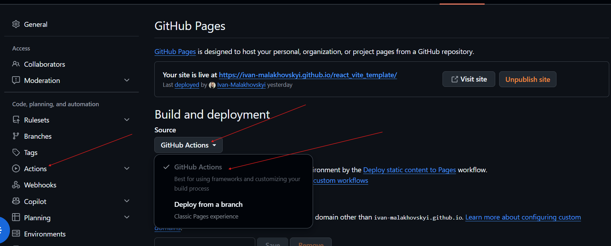

# React + Vite Template

1. Setup:

- after cloning in repo Settings => Pages => Build and deployment => Github
  Actions



- In Settings repo Workflow permissions => set Read and write permissions and
  Allow GitHub Actions to create and approve pull requests


2. React router

## If you are using react-router (Якщо ви використовуєте react-router)

```jsx
  <BrowserRouter basename="/repo_name">
    <App />
  </BrowserRouter>,
```
